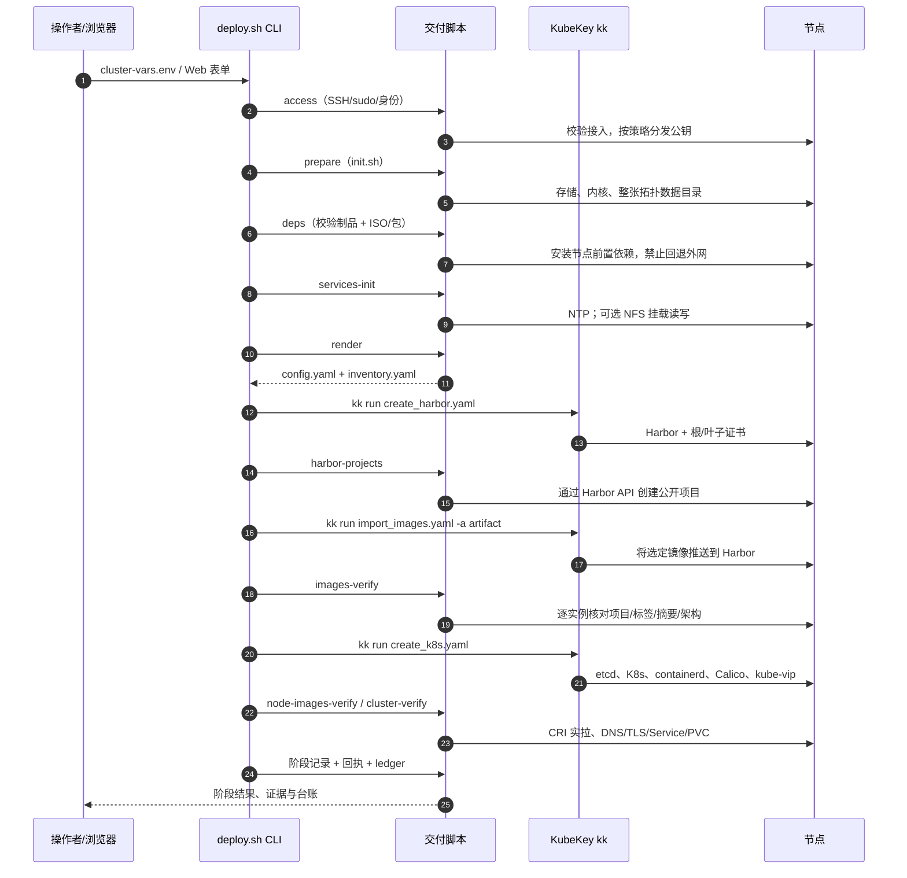

# 架构与执行链路

适用交付：20261114-r5（KubeKey 二进制 v4.0.10，制品仍由 v4.0.9 导出）。本页说明 CLI、Web、交付脚本与 KubeKey 各自负责什么，以及一次首装、维护操作如何串起来。阶段前置与命令细节见 [高级分步参考](staged-install.md)，Web 安装见 [Web 一键部署](web-deployment.md)。

## 1. 分层

| 层 | 组成 | 职责 |
| --- | --- | --- |
| 入口 | [deploy.sh](../deploy.sh)、[web/server.py](../web/server.py)、[web/executor.py](../web/executor.py) | 选择操作、收集参数、只读校验、展示计划；Web 执行器把确认后的任务交给同一个 CLI |
| 配置与渲染 | [lib/config.sh](../lib/config.sh)、[lib/render.sh](../lib/render.sh)、`config-base.yaml`、`inventory-base.yaml` | 校验 54 项设置与 13 列 NODES；生成 KubeKey 的 Config/Inventory |
| 节点准备 | [init.sh](../init.sh)、[lib/access.sh](../lib/access.sh)、[lib/services.sh](../lib/services.sh)、[node_scripts/](../node_scripts) | SSH/sudo/公钥、存储与内核、NTP/NFS、离线 OS 依赖 |
| 安装编排 | [lib/workflow.sh](../lib/workflow.sh)、[lib/components.sh](../lib/components.sh)、[lib/harbor.sh](../lib/harbor.sh)、[lib/images.sh](../lib/images.sh) | 阶段顺序、前置门禁、仓库项目/镜像验收、调用 KubeKey |
| 安装执行 | KubeKey（`kk`）与 [kk-project](../kk-project) 模板 | Harbor、证书、etcd、Kubernetes、containerd、Calico、kube-vip、镜像导入 |
| 验收与台账 | [lib/cluster-verify.sh](../lib/cluster-verify.sh)、[lib/ledger.py](../lib/ledger.py)、`check.sh` | 节点身份、CRI 实拉、DNS/TLS/Service/PVC、XLSX/JSON/HTML/CSV |
| 状态与维护 | [lib/resume.sh](../lib/resume.sh)、[lib/redeploy.sh](../lib/redeploy.sh)、[lib/expansion.sh](../lib/expansion.sh) | 阶段记录、回执、指纹、resume/reset/redeploy/add-workers |

## 2. 一次首装的控制流

说明：

- 新环境走分步 workflow 时，Harbor 与 K8s 分别调用 `create_harbor.yaml`、`create_k8s.yaml`；旧版 `all`/`resume` 路径可能使用合并的 `create_cluster.yaml`。两条路径都以同一份渲染结果和阶段门禁为准。
- `COMPONENTS=harbor` 只走到 `images-verify`/`ledger`；`COMPONENTS=k8s` 跳过 Harbor 安装，只核验已有仓库再安装 K8s；`external-harbor` 不把仓库主机列入 NODES，也不执行 Harbor 安装/项目/导入。

## 3. 责任矩阵

| 事项 | 交付脚本 | KubeKey |
| --- | --- | --- |
| SSH 接入、公钥策略、sudo 检查 | 负责；bootstrap 分发，key/password 不复制密钥 | 使用 inventory 中的连接信息 |
| 存储/内核初始化、数据目录 | 负责 prepare/init | 按 config 使用已准备目录 |
| 离线制品校验、ISO/必需成员 | 负责 verify_artifact 与 tar 安全检查 | 通过 `-a artifact` 使用制品中的镜像/仓库材料 |
| 节点 OS 前置依赖 | 负责 deps.sh（socat/conntrack/ipset/iptables/chrony/NFS 和静态 busybox 等） | 其 native/repository 任务处理自身所需包源 |
| NTP / NFS | 负责 services-init/verify | 按 config 使用时间源、PV/NFS 配置 |
| Config/Inventory 渲染 | 负责 | 读取并执行 |
| Harbor 安装与服务证书 | 不安装；只复制/校验公开 CA | 负责 image-registry 角色与 certs/init 签发、分发 |
| Harbor 项目创建 | 负责 harbor.sh（API） | 不负责业务项目 |
| 镜像导入 | 负责准备制品、调用并验收 | 负责 import_images.yaml 的 upload |
| 镜像验收 | 负责逐实例 project/tag/digest/arch 核对 | 不负责 |
| etcd/K8s/CRI/CNI/VIP | 负责前置与验收 | 负责安装、证书、kubeadm/Calico/kube-vip |
| 节点 CRI 实拉、DNS/TLS/Service/PVC | 负责 node-images-verify、cluster-verify | 不负责 |
| 台账 | 负责 ledger | 不负责 |
| 回执/指纹/停止边界 | 负责 workflow + receipt | 不负责 |
| reset/redeploy/add-workers | 负责编排、校验、证据 | 执行 reset_cluster.yaml 等 playbook |

## 4. 输入、产物与状态

- **配置**：`cluster-vars.env` 是唯一输入；`NODES` 每行 13 列，支持 `native/existing/auto/format` 数据策略。密码只从环境变量/一次性表单传入，不进入状态或台账。
- **渲染**：`render_configs` 生成 `config.yaml`（KubeKey Config）和 `inventory.yaml`（hosts/roles/连接方式）。运行目录 0700、文件 0600；预览使用占位密码，实际安装才使用 `LIVE_RENDER`。
- **制品**：`kubekey-artifact.tgz` + `ARTIFACT_SHA256` + 内层 `manifests.yaml`/ISO/工具；安装前校验摘要、tar 路径/类型和必需成员，再交给 KubeKey。
- **状态**：`STATE_DIR.deployment`（K8s/Harbor 回执）、`STATE_DIR.harbor.deployment`、`STATE_DIR.workflow`（阶段 JSON + 指纹 + 身份/证据摘要）、`runs/`（每阶段配置、日志、报告）。
- **BYO CA**：可选 `PKI_ROOT_CERT`/`PKI_ROOT_KEY`；在 KubeKey 前校验并复制到 `WORK_DIR/pki`，渲染固定 `certs.ca.gen_cert_policy=IfNotPresent`，已有根不一致时拒绝。
- **Web**：草稿在项目外 0700 目录；只读校验/计划复用 `deploy.sh config-check/plan`；执行器以 root 的 Unix socket 接收任务，最终运行 `deploy.sh all --env <生成配置> --non-interactive`，计划 ID、配置摘要、确认勾选、`request_id` 幂等和集群名占用都在执行器侧校验。

## 5. 失败与恢复边界

- 阶段失败不发布成功；阶段记录与证据摘要不匹配时拒绝复用。
- prepare 中断时禁止自动重做存储操作；停止只在阶段边界生效，不回滚。
- `resume` 只接受 `running`/`interrupted` 回执；`complete`、`reset`、缺失或损坏状态都拒绝。
- reset 后必须 redeploy；redeploy 开始重建时归档旧 `.workflow` 记录，避免 reset 前的 succeeded 阶段被复用。
- 已完成集群不为验证新代码重跑首装；维护统一回 CLI。Web 当前只开放新环境首装。
- HA Harbor 在 Web 只开放配置、校验和只读计划；`ha-harbor` 提交执行会被拒绝，须完成 VIP/token/VRID 实机验收后由 CLI 执行。

## 6. 相关手册

- [高级分步参考](staged-install.md)：逐阶段前置、命令与诊断证据
- [Web 一键部署](web-deployment.md)：执行器启动、提交、日志与停止边界
- [维护与故障处理](operations.md)：resume/redeploy/reset/扩容和 BYO CA
- [KubeKey v4.0.10 评估](kubekey-4.0.10.md)：Harbor 证书来源、模板修复与回退
- [后续优化点](optimization-backlog.md)：尚未实施的边界
